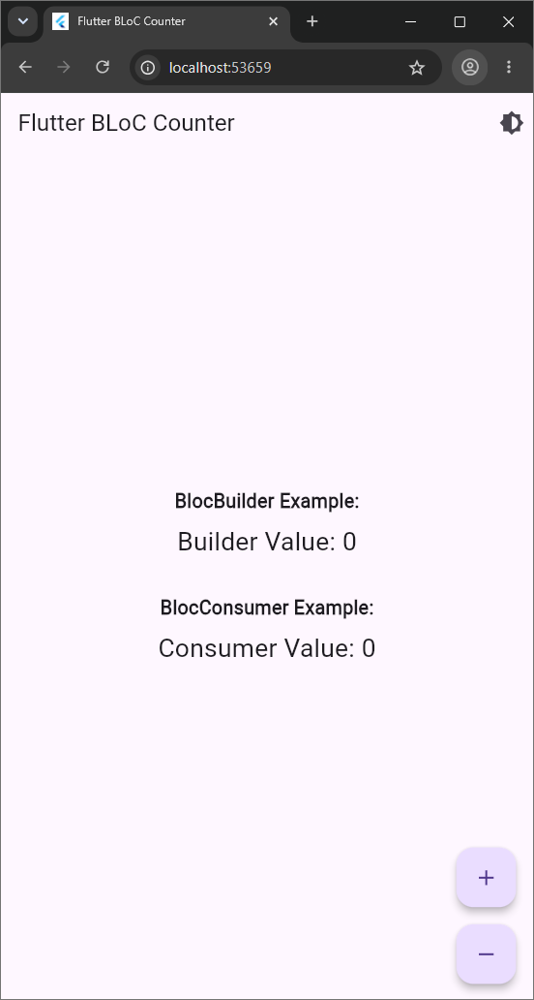
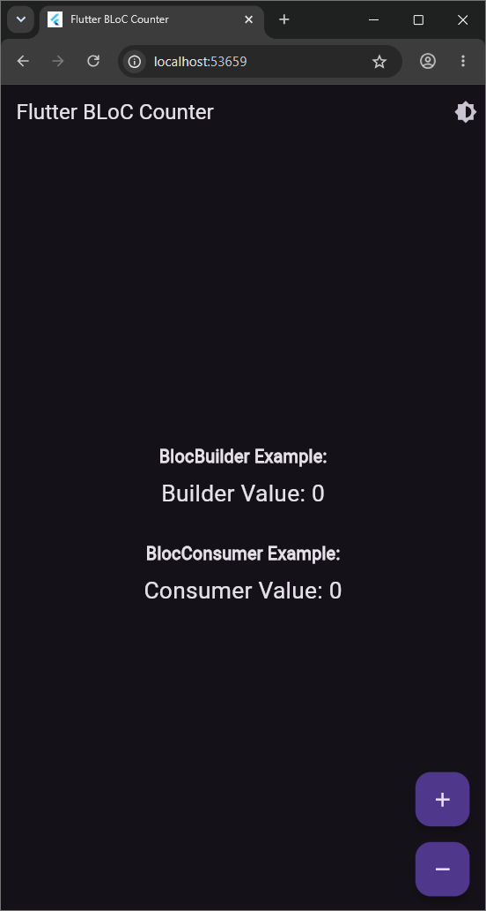
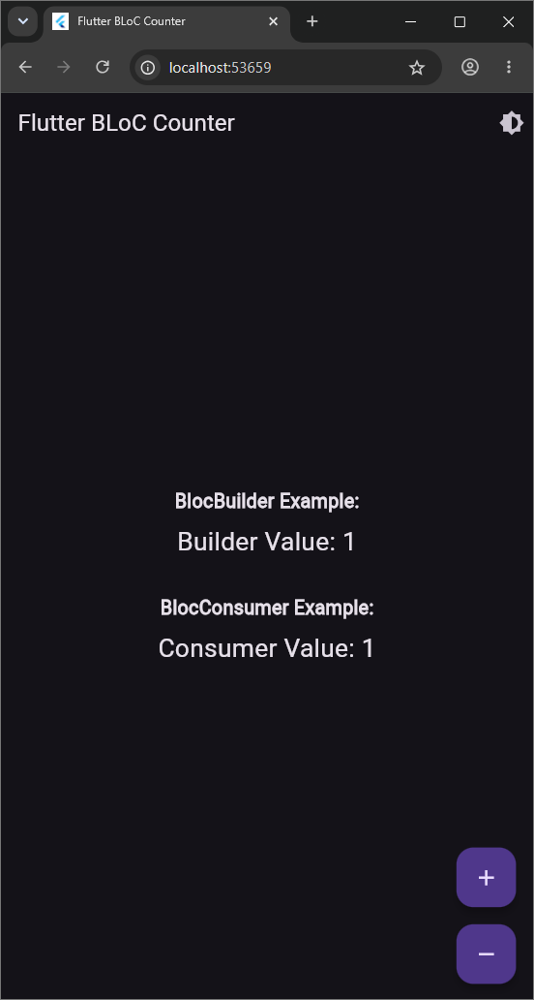
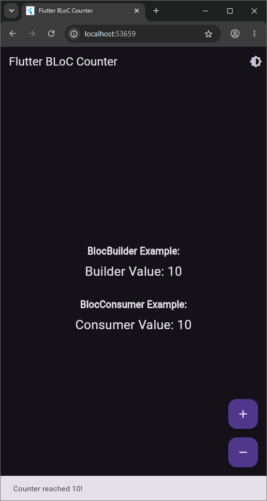
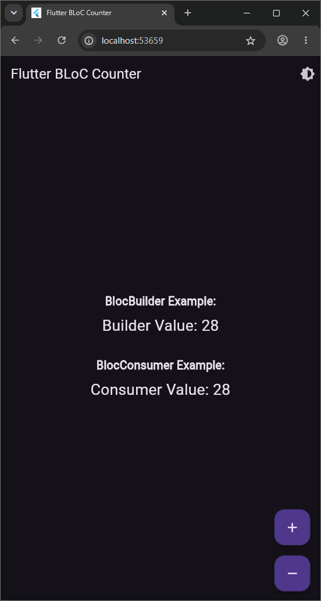

# Flutter State Management — Mini Project

This is a Flutter Counter App that demonstrates state management using the `flutter_bloc` package. 
It follows the BLoC pattern from understanding different types of BLoCs to using `BlocListener`, `BlocBuilder`, and `BlocConsumer`.

## Features

- **Counter Bloc/Cubit:** Manages the state of an integer counter.
- **Theme Bloc:** Toggles between light and dark themes.
- **BlocBuilder:** Dynamically rebuilds the UI to display the current counter value.
- **BlocListener:** Shows a dialog alerting the user when the counter drops below zero.
- **BlocConsumer:** Handles both rendering the counter and showing a SnackBar when the value reaches `10` or `-10`.

## Architecture

- **`lib/bloc/counter_bloc.dart`**: Created for Phase 1 to handle counter increment/decrement using `Bloc`.
- **`lib/bloc/theme_bloc.dart`**: Controls the app theme with standard `Bloc`.
- **`lib/cubit/counter_cubit.dart`**: Implemented for Phase 3 for simpler counter management using `Cubit`.
- **`lib/screens/home_screen.dart`**: The main user interface that uses `BlocProvider`, `BlocListener`, `BlocBuilder`, and `BlocConsumer`.
- **`lib/main.dart`**: Initializes the app with `MultiBlocProvider` to pass both `ThemeBloc` and `CounterCubit` down the widget tree.

## Getting Started

1. Ensure you have the Flutter SDK installed.
2. Run `flutter pub get` to download the dependencies (`flutter_bloc`).
3. Run `flutter run` to launch the application.

## Non-Functional Requirements Handled
- Clear variable and file names.
- Short comments explaining BLoC logic.
- Modularized architecture (each BLoC/Cubit and screen in its own file).
- No unused code or imports.
- Formatted with `dart format`.

## Screenshots

  
  
  
  
  

